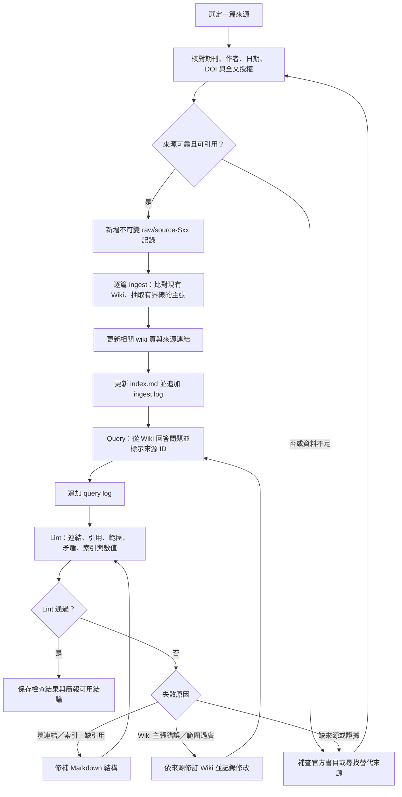

# Ingest、Query、Lint 與修正流程

## 迴圈與判定

- **來源迴圈**：證據不足、來源無法確認或全文限制妨礙核對時，回到來源查核；不以常識補成研究結論。
- **內容迴圈**：Query 暴露過度概括、來源範圍遺失或概念混淆時，先改 Wiki，再重做該 Query 和相關 Lint。
- **結構迴圈**：壞連結、缺引用、索引不一致時，只修受影響的 Markdown 頁並重跑對應檢查。
- 每一輪的實際輸入、輸出、檢查與修正都記入 `log.md` 和相應的 `checks/` 紀錄；此圖是規格，不代替執行證據。
